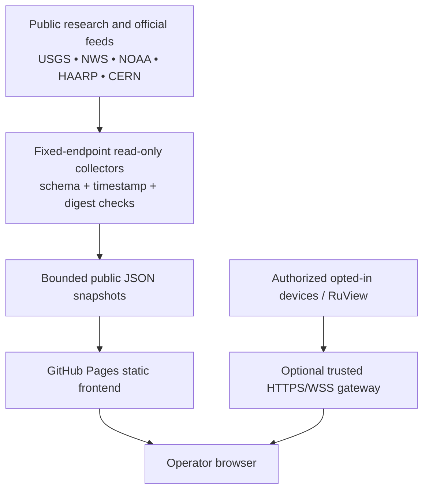

# SkyNet Main — Predictive Intelligence Network

[](https://github.com/BlockChain-BailBonds/SkyNet/actions/workflows/ci.yml)
[](https://github.com/BlockChain-BailBonds/SkyNet/actions/workflows/pages.yml)
[](https://github.com/BlockChain-BailBonds/SkyNet/actions/workflows/security-checks.yml)

**Intellectual property by Matthew Blake Ward, in association with 918 Technologies.**

SkyNet is an evidence-first environmental, space-weather, scientific-research, and voluntary local-sensor awareness platform. It combines a GitHub Pages operator frontend with bounded public-data collectors and **separate optional local or hosted backends**. It does not infer physical sensing or production readiness from a website being accessible.

**Repository:** https://github.com/BlockChain-BailBonds/SkyNet

**Publishing status, 14 November 2026:** source validation for the CERN integration passed, but GitHub Pages deployment was **BLOCKED** at `actions/configure-pages@v5` because a Pages site was not enabled. The repository administrator must set **Settings → Pages → Build and deployment → Source: GitHub Actions** once. A passing CI run or a committed HTML file does not establish successful publication. See [Launch runbook](docs/launch.md) and [Pages workflow](.github/workflows/pages.yml).

> **Scientific boundary:** The system is a research and situational-awareness tool, not an emergency warning service, medical monitor, live satellite tracker, telescope, or guaranteed forecasting system. Published third-party records, website status, and sensor measurements have different meanings.

## Quick access

| Resource | Location | Verified purpose |
| --- | --- | --- |
| Main operator console | [`index.html`](index.html) | Static application entrypoint |
| Legacy geospatial dashboard | [`static/index.html`](static/index.html) | Map/consent interface; backend optional |
| CERN Intelligence Network | Main console → **CERN Intelligence** | Bounded, read-only public-research metadata |
| Solar Watch & HAARP | Main console → **SolarWatch + HAARP** | NOAA observations and HAARP research links |
| Sensor Agents & Training | Main console → **Sensor Agents & Training** | Source monitor evidence and shadow candidates |
| Chimera Lab | [`chimera/index.html`](chimera/index.html) | Separate GitHub analysis interface, requires its backend for live results |
| Pages deployment run | [GitHub Actions](https://github.com/BlockChain-BailBonds/SkyNet/actions/workflows/pages.yml) | Build/test/collect/package/deploy evidence |
| Pages setup | [Repository Pages settings](https://github.com/BlockChain-BailBonds/SkyNet/settings/pages) | Required one-time admin configuration |

Do not assume the conventional project URL `https://blockchain-bailbonds.github.io/SkyNet/` works until a successful Pages deployment and external HTTPS check confirm it.

## What is implemented

- **Static SkyNet Main:** black-and-gold responsive dashboard, alert/source health, forecasts, space-weather and science monitors, evidence panels, and optional user-initiated browser model runtime.
- **USGS + NWS:** bounded earthquake and weather-alert snapshot adapters, deterministic normalization and deduplication. `forecast.ingest` can refresh these locally and in a separate workflow; source age must be checked before use.
- **NOAA SWPC:** G/R/S scales, planetary Kp, GOES flare reports, and bulletins via published read-only endpoints. Observations and recent reports are not guaranteed forecasts.
- **HAARP:** published array specifications, research notices, and public diagnostic pages. No operating-state inference or individual antenna access.
- **CERN Intelligence:** six independent public-source agents (CMS, ATLAS, ALICE, LHCb, CLOUD research page, LHC Vistar display directory). Dataset results are archival catalog metadata, not a live particle stream.
- **Per-source evidence:** bounded requests, SHA-256 response digests, independent agent status, recorded collection timestamps and chain-linked collection receipts. Hashes cannot prove the scientific correctness of a measurement.
- **Shadow analysis:** only validated timestamped numeric sources may produce unapproved descriptive candidates. No automatic threshold/model promotion.
- **Local RuView integration:** an optional local HTTP gateway supports constrained read-only RuView health and sensing summaries. A running local process is not a deployed public service.
- **Opt-in invitations:** a separate HTTPS gateway is necessary for phone-motion enrollment; the Pages website alone cannot accept enrollment POSTs or authenticated ESP32 uplinks.
- **SkyNet Pocket:** firmware scaffolding and simulator only; actual sensor enrollment, CSI reporting, camera, or hardware acceptance require separate direct evidence.

## Architecture and trust boundaries



**The private path is architecturally separate.** GitHub Pages does not host persistent Python, receive arbitrary HTTP POSTs, operate a WebSocket relay, or verify real-world hardware on its own. The frontend must not display simulated or unverified device data as physical acceptance.

## Start locally

Requirements: Python 3.10+ (standard library for the main gateway/collectors), a current browser, and internet connectivity for external public sources. Node.js is useful for JavaScript syntax checks.

```bash
git clone https://github.com/BlockChain-BailBonds/SkyNet.git
cd SkyNet
python3 -m unittest discover -s tests -v
python3 server.py
```

Open **http://127.0.0.1:8787**. The listener defaults to loopback. An optional static-only preview can also be served with `python3 -m http.server 8788`, but backend routes will not be available on that preview.

Public-source refresh commands run from the repository root:

```bash
python3 -m forecast.ingest
python3 -m forecast.space_weather --allow-blocked
python3 -m forecast.haarp
python3 -m forecast.cern --allow-blocked
python3 -m sensor_agents.report
```

The first command may exit nonzero if all requested USGS/NWS feeds fail. The CERN and NOAA `--allow-blocked` options retain explicit degraded status rather than claiming retrieval success. `sensor_agents.report` requires a NOAA observation report from `forecast.space_weather`. Some data products may be missing if sources are unavailable; absence is not a zero-valued observation.

## CERN public-research subsystem

| Agent | Public endpoint / subject | What successful retrieval proves | What it does **not** prove |
| --- | --- | --- | --- |
| `CERN.CMS` | [CERN Open Data](https://opendata.cern.ch/) CMS records | Search response and bounded dataset metadata | Live collisions or CMS detector telemetry |
| `CERN.ATLAS` | CERN Open Data ATLAS records | Public record metadata | Live ATLAS detector access |
| `CERN.ALICE` | CERN Open Data ALICE records | Public record metadata | Live collision observations |
| `CERN.LHCB` | CERN Open Data LHCb records | Public record metadata | Beam conditions or live events |
| `CERN.CLOUD` | [CLOUD experiment](https://home.cern/science/experiments/cloud/) | Public research webpage reachable | Aerosol, cosmic-ray, or chamber sensor samples |
| `CERN.LHC_VISTAR` | [LHC displays](https://vistar-capture.s3.cern.ch/index.html) | Public display-directory page reachable | Decoded screen measurements or accelerator controls |

Run `python3 -m forecast.cern --allow-blocked`. Its output is `data/public/cern-status.json`: six source records, evidence hashes, last collection time and clear `BLOCKED` classifications. Input URLs are fixed; responses are size-bounded, HTTPS-only and schema-checked, with same-host redirect checks. The browser treats snapshots older than **90 minutes** as stale.

The initial 14 November 2026 CI network smoke test retrieved **five of six** public sources; one was blocked. This is a historical test result, not a promise about current CERN availability. Correlation/training remains blocked because metadata-only inputs do not contain comparable, calibrated physical time series. See [complete CERN design and limits](docs/cern.md).

## Sensor agents and training gates

Four NOAA agents, nine HAARP source agents, and six CERN public-source agents are defined. They have independent source statuses; they are **not nineteen fully trained physical sensors**. NOAA sensor reporting uses a source-specific hash chain and a quality-gated **shadow-only** descriptive Kp candidate. HAARP and CERN catalog agents record metadata; they cannot generate meaningful numerical sensor training without actual authorized, licensed, calibrated observations.

Never automatically promote checkpoints or advertise forecasting accuracy without time-separated validation, calibration/provenance, baseline comparison, red/blue tests, and an explicit operator approval and rollback target. See [sensor agent design](docs/sensor-agents.md).

## Evidence labels

| Label | Precise meaning |
| --- | --- |
| **VERIFIED** | A specifically named check succeeded, e.g. public HTTPS response parsed, CI tests passed, or a particular deployment step succeeded. Always identify the scope. |
| **UNVERIFIED** | Physical truth, sensor identification, timing, calibration, interpretation, or provenance has not been established. |
| **BLOCKED** | Required source, key, infrastructure, permission, timestamp, or verification step is unavailable. |
| **FAILED** | A concrete, executed acceptance test returned a negative result. |
| **SIMULATED** | Explicit offline demonstration or synthetic device input; never a real enrolled sensor. |

Successful retrieval of CERN catalog JSON, HAARP charts or NOAA bulletin text is **source access only**. It never implies live control, active transmitter operation, particle-event capture, biological sensing, verified solar-event prediction, or real-time hardware ingestion.

## GitHub Pages publication — required one-time setup

1. Open [SkyNet repository Pages settings](https://github.com/BlockChain-BailBonds/SkyNet/settings/pages) with an account authorized to administer the repository.
2. In **Build and deployment**, select **Source: GitHub Actions**. Do not select a template: `.github/workflows/pages.yml` already defines deployment.
3. Open [Publish SkyNet Main workflow](https://github.com/BlockChain-BailBonds/SkyNet/actions/workflows/pages.yml), select **Run workflow**, branch `main`, then start it; a reviewed push to `main` also triggers it.
4. Check that unit tests, JavaScript syntax, source snapshots, staging, asset preflight, Pages configuration, artifact upload and deployment each succeed. The workflow also retains a downloadable **`skynet-pages-ready`** artifact even if the final Pages-enablement gate is blocked.
5. Open the **actual site URL returned by GitHub Pages**, confirm HTTPS, response 200, console HTML, local CSS/JS assets, and the CERN panel's latest snapshot status.
6. Independently verify any external HTTPS/WSS backend and enrolled hardware, using their own logs and signed telemetry. Frontend success does not prove those systems.

**Why a code-only fix is insufficient:** `actions/configure-pages@v5` cannot create a Pages site with the default `GITHUB_TOKEN`, even when `pages: write` is granted. Adding `enablement: true` without a separately authorized administration-capable token fails; the intended repair is the one-time Settings change. See [GitHub official publishing documentation](https://docs.github.com/en/pages/getting-started-with-github-pages/configuring-a-publishing-source-for-your-github-pages-site).

A deployable artifact in Actions is **not** a published URL. Scheduled workflows are best effort; they may be delayed or skipped. GitHub Pages publication is neither a real-time ingestion service nor an always-on forecast server.

## CI and monitoring

| Workflow | Scope | Trigger |
| --- | --- | --- |
| [`ci.yml`](.github/workflows/ci.yml) | Python 3.10/3.13 tests, public CERN bounded smoke test, hash manifest, JS syntax | Push and pull request |
| [`security-checks.yml`](.github/workflows/security-checks.yml) | Credential-shaped data rejection and public-asset checks | See workflow |
| [`pages.yml`](.github/workflows/pages.yml) | Build and deploy Main + CERN/NOAA/HAARP snapshots | Main push, manual dispatch, best-effort 15-minute schedule |
| [`solar-watch.yml`](.github/workflows/solar-watch.yml) | Independent public NOAA monitoring and evidence artifact | Main push, manual dispatch, best-effort quarter-hour schedule |
| [`forecasts.yml`](.github/workflows/forecasts.yml) | USGS/NWS bounded snapshot artifact | Manual dispatch, best-effort two-hour schedule |

The latest verifiable test/CI history is in [Actions](https://github.com/BlockChain-BailBonds/SkyNet/actions). A green source-validation job does not override a red Pages deployment job.

## Local gateway and credentials

The local server defaults to `127.0.0.1:8787`. Read-only routes include `GET /api/health`, `/api/config`, `/api/ruview`, `/api/scan` and `/api/evidence`. See [gateway source](server.py) for the exact request contract.

An optional trusted LAN RuView source can be configured with `RUVIEW_URL` and deliberate `RUVIEW_ALLOW_LAN=1`. If a private RuView API token is required, provide it only to a trusted server process via `RUVIEW_API_TOKEN`; never add it to a Pages file, browser local storage, URLs, CI logs or repository history.

Opt-in invitation endpoints are implemented by [`optin.py`](optin.py) and the local gateway. They require `SKYNET_ADMIN_TOKEN` and a correctly configured `SKYNET_PUBLIC_URL` for external invite use. There is no built-in SMS sending service: the operator sends an invitation using their own messaging app. Browser camera, microphone, and motion permissions require a voluntary opt-in; phone-motion sensing is **not** RuView CSI. See [SMS enrollment guide](SMS_ENROLLMENT_GUIDE.md).

**Never use `SKYNET_ALLOW_REMOTE=1` as a substitute for authentication, TLS or network controls.** It changes the listener safeguard, not the gateway's fundamental security model. A production HTTPS/WSS gateway and physical Pocket heartbeat have not been verified by Pages deployment.

## Tests, regression, and rollback

```bash
python3 -m unittest discover -s tests -v
python3 -m unittest tests.test_cern -v
sha256sum -c MANIFEST.sha256
node --check static/assets/spin.js
node --check static/assets/cern.js
```

The checked source manifest must be updated when its listed source files change. Network smoke tests tolerate explicitly blocked public sources but cannot fabricate successful remote ingestion. Preserve artifact checksums, timestamp and exact source URL alongside any reported output.

For rollbacks, review the failing Actions step, revert the offending change through Git, and redeploy the previous tested revision. Do not remove consent checks, authenticity boundaries, and evidence labels to make a deployment appear green. See [deployment plan](docs/deployment.md), [launch gates](docs/launch.md), and [security model](docs/security.md).

## Repository layout

```text
.github/workflows/        Source CI, security, Pages, solar monitoring, forecasts
index.html                SkyNet Main entrypoint
static/assets/            Browser components and CERN view
static/index.html         Preserved geospatial/consent dashboard
static/join.html          Opt-in phone-motion join page (backend required)
forecast/                 USGS, NWS, NOAA, HAARP, CERN public collectors
sensor_agents/            Per-source hash-linked evidence and shadow training
data/public/              Bounded published research and environment snapshots
alerts/                   Deterministic alert classification
pocket/                   ESP32 firmware candidate and simulator
chimera/                  Separate analysis UI and optional backend
server.py                 Local read-only gateway and approved enrollment routes
tests/                    Offline and network-safe validation suites
docs/                     Architecture, launch, CERN, HAARP, security, agent guides
MANIFEST.sha256           Source integrity reference for listed paths
```

## Third-party rights, limitations, and attribution

Original SkyNet integration material: **© 2026 Matthew Blake Ward, in association with 918 Technologies. All rights reserved.** This attribution is for the newly authored integration and documentation and does not claim ownership or licensing rights in RuView, CERN, NASA, NOAA, USGS, GitHub, Google, ESA, or other providers' software, imagery, feeds, instruments or trademarks. Comply with each data product's availability, acceptable use, citation and redistribution terms.

See [IP notice](IP_NOTICE.md), [third-party notices](THIRD_PARTY_NOTICES.md), [architecture](docs/architecture.md), [evidence report](docs/evidence-report.md), and [CERN integration](docs/cern.md).
